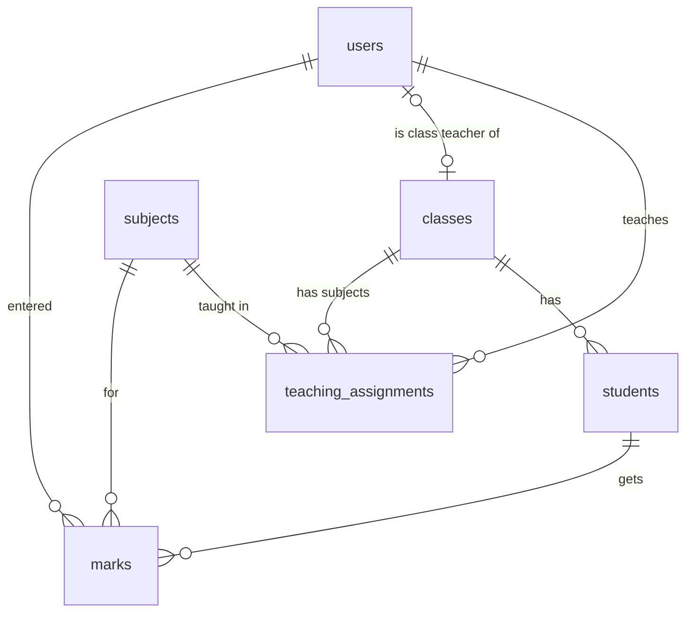

# Database design – `school_grading` (MySQL / MariaDB)

**Where it runs**
| Stage | Server | Tool |
|---|---|---|
| Local (Milestone 2) | XAMPP → MariaDB 10.4.32 on `localhost:3306`, user `root` (no password) | phpMyAdmin `http://localhost/phpmyadmin` |
| Cloud (later) | Azure Database for MySQL 8 (Flexible Server) | DBeaver |

**Character set / collation:** `utf8mb4` / `utf8mb4_general_ci` – full Unicode,
case-insensitive (so `Sania@School.com` and `sania@school.com` match), and
identical on MariaDB and MySQL 8 so the phpMyAdmin export imports into Azure
without errors.

**How the tables are created:** *code-first*. Each table below is a C# class in
the API (`entities/`), configured in `AppDbContext` (`modelBuilder…`), and
created by `Update-Database` (EF Core migrations) in Milestone 4. The demo rows
are added with `HasData(...)` – the same data the Flutter mock (`DummyDB`) uses.

**Naming:** table names are lower-case `snake_case` (`teaching_assignments`),
column names are the C# property names (`FullName`, `ClassId`) – the EF Core
default. MySQL column names are case-insensitive.

---

## The 6 tables

### 1. `users` – everyone who can log in
| Column | Type | Rules |
|---|---|---|
| `Id` | int | **PK**, auto-increment |
| `FullName` | varchar(100) | required |
| `LoginId` | varchar(100) | required, **UNIQUE**, never changes (e.g. `sania@school.com`) |
| `ContactEmail` | varchar(150) | optional – real Gmail used to send login details |
| `PasswordHash` | varchar(100) | required – **BCrypt hash**, never the plain password |
| `Role` | varchar(20) | `admin`, `teacher` or `vp` |
| `MustChangePassword` | tinyint(1) | 1 = temporary password, must change at next login |
| `CreatedAt` | datetime(6) | when the account was created |

### 2. `subjects`
| Column | Type | Rules |
|---|---|---|
| `Id` | int | **PK** |
| `Name` | varchar(50) | required, **UNIQUE** (English, Mathematics, Physics, Chemistry, Biology) |
| `MaxMarks` | int | 100 or 60 |

### 3. `classes` – a class + section, e.g. Class 8 - B
| Column | Type | Rules |
|---|---|---|
| `Id` | int | **PK** |
| `GradeName` | varchar(20) | e.g. `Class 8` |
| `Section` | varchar(5) | e.g. `B` |
| `ClassTeacherId` | int | **FK → users.Id**, optional, **UNIQUE** (a teacher leads at most one class), `ON DELETE SET NULL` |
| `ResultsPublishedAt` | datetime(6) | NULL = not published. Not NULL = published → marks & students **locked** |
| | | **UNIQUE (`GradeName`, `Section`)** – no duplicate "Class 8 - B" |

### 4. `students`
| Column | Type | Rules |
|---|---|---|
| `Id` | int | **PK** |
| `FullName` | varchar(100) | required |
| `RollNo` | varchar(10) | `01`, `02`, … |
| `ClassId` | int | **FK → classes.Id**, `ON DELETE RESTRICT` (cannot delete a class that still has students) |
| | | **UNIQUE (`ClassId`, `RollNo`)** – roll numbers unique inside a class |

### 5. `teaching_assignments` – *who teaches which subject in which class*
| Column | Type | Rules |
|---|---|---|
| `Id` | int | **PK** |
| `ClassId` | int | **FK → classes.Id** |
| `SubjectId` | int | **FK → subjects.Id** |
| `TeacherId` | int | **FK → users.Id** |
| `SubmittedAt` | datetime(6) | NULL = not submitted yet; set when the teacher presses **Submit** |
| | | **UNIQUE (`ClassId`, `SubjectId`)** – exactly one teacher per subject per class |

This table is what powers the **Class Teacher's live submission tracker**:
for each subject of a class it tells us the teacher, and whether they submitted.

### 6. `marks`
| Column | Type | Rules |
|---|---|---|
| `Id` | int | **PK** |
| `StudentId` | int | **FK → students.Id**, `ON DELETE CASCADE` (deleting a student deletes their marks) |
| `SubjectId` | int | **FK → subjects.Id** |
| `Obtained` | int | 0 … subject's `MaxMarks` (checked by the API) |
| `EnteredById` | int | **FK → users.Id** – which teacher entered it |
| `UpdatedAt` | datetime(6) | last time it was saved |
| | | **UNIQUE (`StudentId`, `SubjectId`)** – one mark per student per subject |

---

## Relationships (ERD)

In words:
* A **class** has many **students** (1 → many).
* A **class** has 5 **teaching assignments** (one per subject); each links a
  **subject** and a **teacher** (many ↔ many between classes, subjects and
  teachers, resolved by this "junction" table).
* A **student** has one **mark** per **subject** (many ↔ many between students
  and subjects, resolved by `marks`).
* A **class** has at most one **class teacher**, and a teacher is class teacher
  of at most one class (1 ↔ 1, optional).

## Rules the database itself enforces
| Rule | How |
|---|---|
| No two users with the same Login ID | UNIQUE `users.LoginId` |
| One teacher per subject per class | UNIQUE (`ClassId`, `SubjectId`) |
| One mark per student per subject | UNIQUE (`StudentId`, `SubjectId`) |
| Roll numbers unique inside a class | UNIQUE (`ClassId`, `RollNo`) |
| A mark always belongs to a real student/subject | Foreign keys |
| Deleting a student removes their marks | `ON DELETE CASCADE` |

Business rules (marks between 0 and max, "cannot edit a published class",
"only the class teacher can publish", password rules…) are checked in the
**API controllers**, because they depend on who is logged in.

## Demo data (seeded in Milestone 4 – same as the Flutter mock)
* **Users** (password `123` for all, stored as BCrypt hashes):
  `admin@school.com` (Admin), `vp@school.com` (VP Sarah),
  `sania@school.com`, `ahsan@school.com`, `maryam@school.com`, `usman@school.com` (Teachers)
* **Subjects:** English 100, Mathematics 100, Physics 60, Chemistry 60, Biology 60
* **Classes:** 8-A (CT Ahsan), 8-B (CT Sania), 9-A (CT Maryam), 9-B (CT Usman), 9-C (none)
* **Teaching assignments:** every class has all 5 subjects
  (English Ahsan, Maths Maryam, Physics Usman, Chemistry + Biology Sania) = 25 rows
* **Students:** 5 per class = 25 (8-B: Sarah, Ahmed, Zain, Fatima, Bilal)
* **Marks:** 8-A Chemistry submitted; 8-B English/Maths/Biology submitted,
  Physics + Chemistry in progress; 9-A all 5 submitted (ready to publish).

## Files in this folder
| File | Purpose |
|---|---|
| `01_create_database.sql` | Creates the empty database with the right collation (same as the phpMyAdmin step) |
| `README.md` | This design document |
| `02_initial_create_generated_by_ef.sql` | The SQL that EF Core generated from the C# entities (what Update-Database ran) – for reading only |
| *(Milestone 3)* `school_grading_export.sql` | phpMyAdmin export used to migrate to Azure |

## How the tables were created (Milestone 4)
1. `Add-Migration InitialCreate` (CLI: `dotnet ef migrations add InitialCreate`) – EF Core
   compares the entities + `AppDbContext` with an empty database and writes
   `Migrations/…_InitialCreate.cs` (C# code that creates the 6 tables + inserts demo data).
2. `Update-Database` (CLI: `dotnet ef database update`) – runs that migration on XAMPP MySQL
   and records it in the `__EFMigrationsHistory` table, so it is never applied twice.

**XAMPP note:** XAMPP ships **MariaDB 10.4**, not MySQL 8. One command EF uses
before migrating (`GET_LOCK(..., -1)`) behaves differently on MariaDB, so the API
has a tiny EF Core *interceptor* (`api/SchoolGradingApi/database/MariaDbFix.cs`)
that adjusts only that command. Nothing changes on MySQL 8 / Azure.

**Reset to clean demo data:** drop `school_grading`, run `01_create_database.sql`,
then `Update-Database` again.
